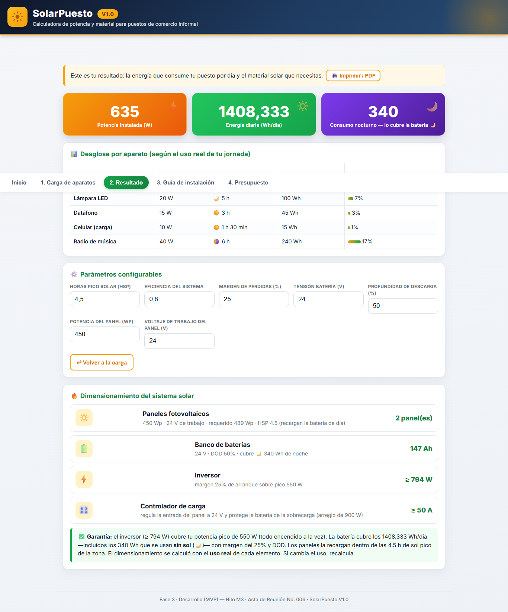
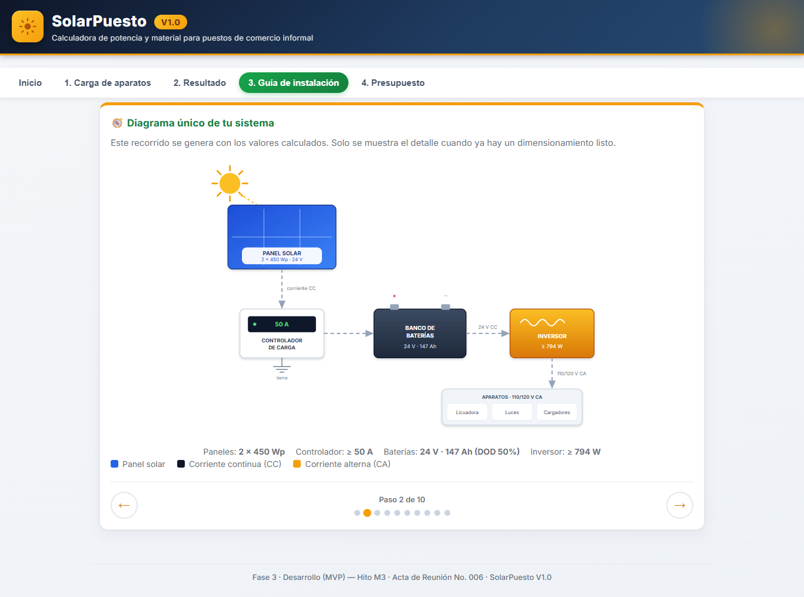
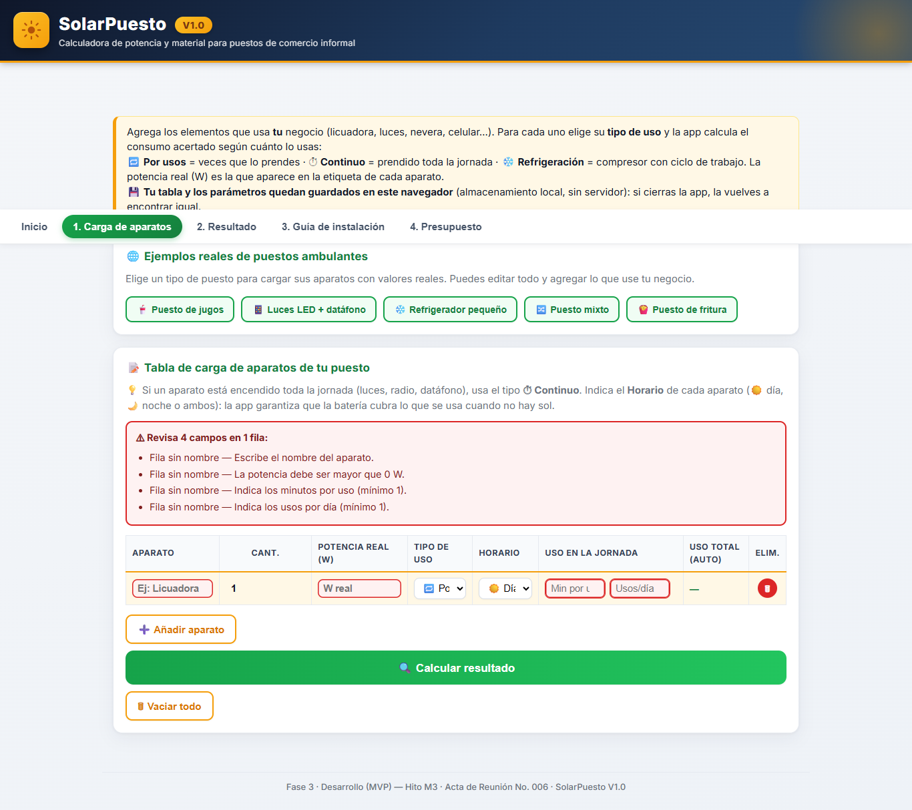

# Informe de Pruebas

**Subtítulo:** SolarPuesto V1.0 — Resultados de la suite automatizada, caja negra, build de producción y evidencias
**Autor:** Heyner Alberto Aldana Herrera
**Docente:** Miguel Antonio Urbano Silva
**Asignatura:** Ingeniería de Software II (XP — TDD)
**Versión del documento:** 1.0
**Fecha:** 06/11/2026
**Entregable:** Informe de pruebas — Fase de pruebas y entrega final

---

## 1. Resumen ejecutivo

La fase de pruebas de SolarPuesto V1.0 se ejecutó sobre la aplicación React + Vite, con una suite automatizada de **113 pruebas** distribuidas en cinco archivos, más una verificación funcional de caja negra y una compilación de producción.

Resultados principales:

| Indicador | Resultado |
|---|---|
| Pruebas automatizadas ejecutadas | 113 |
| Pruebas aprobadas | 113 |
| Pruebas fallidas | 0 |
| Archivos de prueba | 5 |
| Tiempo de la suite | 5,62 s |
| Build de producción | Exitoso (43 módulos, 936 ms) |
| Defectos funcionales encontrados | 1 (DEF-01, corregido y verificado) |
| Defectos abiertos de severidad alta | 0 |
| Evidencias gráficas | 9 capturas de pantalla |

El defecto DEF-01 afectaba la guía de instalación: después de calcular, el resumen mostraba "Sin calcular" y el diagrama mostraba valores `undefined` y `NaN`. Se corrigió el contrato de salida del módulo de dimensionamiento y se agregó una prueba de regresión. La suite completa quedó en verde.

---

## 2. Objetivo y alcance

### 2.1 Objetivo

Verificar que SolarPuesto V1.0 cumple los requisitos funcionales y no funcionales del MVP, que los cálculos son coherentes con el modelo matemático y que la interfaz responde de forma segura ante entradas inválidas, datos persistidos y flujos incompletos.

### 2.2 Alcance

Se probaron:

- Los módulos puros de cálculo (`formulas.js`), validación (`validaciones.js`) y persistencia (`almacen.js`).
- Los componentes principales a través de React Testing Library: tabla de carga, resultado, guía, presupuesto, inicio y navegación.
- El flujo completo de caja negra: cargar ejemplo, editar, calcular, leer resultado, navegar la guía y consultar el presupuesto.
- La compilación de producción con Vite.
- La presentación visual en Chrome, mediante capturas reales.

No se probaron en esta fase:

- Pruebas de carga con múltiples usuarios simultáneos (la aplicación no tiene servidor).
- Pruebas formales de accesibilidad con lector de pantalla.
- Medición formal de rendimiento con Lighthouse.
- Pruebas en dispositivos móviles físicos.
- Pruebas de penetración o seguridad ofensiva.

---

## 3. Entorno de ejecución

| Elemento | Versión o detalle |
|---|---|
| Sistema operativo | Microsoft Windows 11 Pro |
| Node.js | v24.13.1 |
| npm | 11.8.0 |
| React | 18.3.1 |
| Vite | 5.4.21 |
| Vitest | 2.1.9 |
| React Testing Library | 16.0.1 (con jsdom 25) |
| Navegador de evidencias | Google Chrome 156.0.8078.80 |
| Fecha de ejecución | 06/11/2026 |
| Directorio del proyecto | `C:\Users\Heyner\Desktop\SolarPuesto\app` |

Los comandos se ejecutaron en PowerShell, sin elevación de administrador, desde la carpeta de la aplicación.

---

## 4. Estrategia de pruebas

| Nivel | Herramienta | Alcance | Resultado |
|---|---|---|---|
| Unitarias | Vitest | Fórmulas, validaciones y persistencia | 72 pruebas |
| Componentes | React Testing Library + jsdom | Tabla, resultado, guía, navegación | 6 pruebas |
| Caja negra | React Testing Library + jsdom | Flujo completo solo a través de `<App />` | 35 pruebas |
| Build | Vite | Compilación de producción | Exitoso |
| Manual / evidencias | Chrome headless | Presentación visual y flujos principales | 9 capturas |

La suite de caja negra es deliberadamente independiente de los módulos internos: solo importa el componente raíz `<App />` y opera con la interfaz visible (botones, campos, textos y navegación). Esto permite detectar defectos de integración que las pruebas unitarias no ven.

### 4.1 Distribución de la suite

| Archivo | Tipo | Pruebas |
|---|---|---:|
| `tests/formulas.test.js` | Unitaria | 31 |
| `tests/validaciones.test.js` | Unitaria | 26 |
| `tests/almacen.test.js` | Unitaria | 15 |
| `tests/App.test.jsx` | Componentes | 6 |
| `tests/cajaNegra.test.jsx` | Caja negra | 35 |
| **Total** | | **113** |

---

## 5. Resultados de la suite automatizada

### 5.1 Salida de la ejecución

Comando:

```
npm test
```

Resultado:

```
Test Files  5 passed (5)
     Tests  113 passed (113)
  Duration  5.62s
```

Las 113 pruebas pasaron sin fallos ni pruebas omitidas. La ejecución incluyó los cinco archivos y no produjo errores de consola relevantes.

### 5.2 Pruebas unitarias de fórmulas

Se verificaron los casos U-01 a U-10 del Plan de Pruebas, los casos de referencia del Acta 002 y el controlador de carga (D-06):

- Horas efectivas por tipo de uso: por usos, continuo y refrigeración.
- La cantidad multiplica la potencia una sola vez y no duplica la energía.
- Potencia instalada, energía diaria y potencia pico.
- Redondeo de paneles hacia arriba.
- Capacidad del banco según tensión, DOD y margen.
- Inversor con margen del 25 %.
- Consumo nocturno con horarios noche y ambos.
- Lista vacía sin división por cero.
- Valores exactos de los casos jugos y fritura.
- Controlador de carga con amperajes comerciales (30, 50, 80 A).
- Formato de horas y minutos.

### 5.3 Pruebas unitarias de validación

Se cubrieron las reglas V-01 a V-07:

- Nombre obligatorio y único, normalizando mayúsculas, tildes y espacios.
- Cantidad entera mayor o igual a 1.
- Potencia mayor que 0 W.
- Minutos y usos válidos en el tipo por usos.
- Horas entre 0 y 24 en continuo.
- Horas conectadas y ciclo entre 20 % y 60 % en refrigeración.
- Uso total no mayor a 24 h al día.
- Agrupación de errores por fila y campo.

### 5.4 Pruebas de persistencia

Se verificó:

- Ida y vuelta de tabla y parámetros en `localStorage`.
- Saneamiento de parámetros faltantes o no numéricos.
- Descarte de filas inválidas.
- Corrección de tipo y horario a valores permitidos.
- Migración de la tensión de 12 V a 24 V (D-07) sin perder la tabla.
- Tolerancia a JSON corrupto.
- Comportamiento sin almacenamiento disponible.
- Borrado completo con `vaciar()`.

### 5.5 Pruebas de componentes

Las 6 pruebas existentes verifican:

- Registro de un aparato nuevo y cálculo del resultado.
- Edición sin crear filas duplicadas.
- Eliminación de la fila indicada.
- Estado de espera de la guía sin cálculo.
- Diagrama en espera.
- Generación de la guía después de calcular.

---

## 6. Resultados de caja negra

La suite `cajaNegra.test.jsx` agrega 35 casos agrupados en seis bloques. Todos pasaron.

| Bloque | Casos | Qué cubre | Resultado |
|---|---:|---|---|
| Inicio | 3 | Hero, botón principal, botón secundario | 3/3 |
| Carga de aparatos | 13 | CRUD, ejemplos, cálculo en vivo, cantidad, vaciar, validaciones, edición | 13/13 |
| Resultado | 7 | KPIs, desglose, parámetros, HSP, tensión, estado vacío, impresión | 7/7 |
| Guía | 6 | Espera, diagrama, resumen, capítulos, navegación, regresión DEF-01 | 6/6 |
| Presupuesto | 2 | Estado de espera y tabla con total | 2/2 |
| Persistencia y generales | 4 | Recarga de tabla y parámetros, pestañas, pie de página | 4/4 |
| **Total** | **35** | | **35/35** |

Inventario completo en el Anexo A.

### 6.1 Hallazgo durante la ejecución

Durante la primera ejecución de la suite nueva se presentaron dos fallos de aserción que no correspondían a defectos de la aplicación, sino a supuestos incorrectos del propio test:

1. **RES-02:** el test eliminaba todos los caracteres no numéricos de la celda de energía, incluidos el separador de miles y la coma decimal, y sumaba mal. La aplicación muestra correctamente `1.408,33 Wh` con formato español. Se corrigió el parseo del test.
2. **GUI-03:** el test esperaba `1.408 Wh/día`, pero la guía muestra `1408 Wh/día` sin separador de miles. Se ajustó la expectativa al formato real. Es una diferencia cosmética, no funcional.

Además, la primera versión de GUI-06 esperaba 807 W de inversor, valor del caso Puesto mixto, pero el caso Puesto de jugos produce 794 W. Se corrigió el dato de la prueba. Estos ajustes son mantenimiento de la suite, no defectos del producto.

---

## 7. Defecto encontrado y corregido

### DEF-01 — La guía mostraba "Sin calcular", `undefined` y `NaN` después de calcular

| Campo | Detalle |
|---|---|
| Identificador | DEF-01 |
| Severidad | Alta (información funcional incorrecta y visible) |
| Componente afectado | `app/src/lib/formulas.js` y `app/src/components/GuiaManual.jsx` |
| Detectado por | Prueba de caja negra GUI-06 |
| Estado | Cerrado y verificado |

**Descripción:** después de cargar un ejemplo y pulsar Calcular resultado, la guía de instalación mostraba en el resumen "Banco / Inversor: Sin calcular". En el diagrama, la línea de paneles decía `2 × undefined Wp` y la de baterías `undefined V · 147 Ah (DOD NaN%)`.

**Causa raíz:** la función `dimensionar()` devolvía `vpanel`, pero no `ppanel`, `tension` ni `dod`. La guía leía `datos.ppanel`, `datos.tension` y `datos.dod`, que llegaban como `undefined`. El presupuesto no fallaba porque usaba valores de respaldo (`|| 24`, `|| 0.5`).

**Corrección:** se agregaron `ppanel`, `tension` y `dod` al objeto devuelto por `dimensionar()`, manteniendo `vpanel`. Así todos los consumidores reciben los parámetros resueltos, incluidos los valores por defecto.

**Prueba de regresión:** GUI-06 verifica que, tras calcular el caso Puesto de jugos, la guía muestra:

- `24 V · 147 Ah · ≥ 794 W` en el resumen.
- `2 × 450 Wp` en el diagrama.
- `24 V · 147 Ah (DOD 50 %)` en la línea de baterías.

**Verificación:** la suite completa pasó de 112 a 113 pruebas después de agregar GUI-06, sin fallos. El defecto quedó cerrado.

---

## 8. Build de producción

Comando:

```
npm run build
```

Resultado:

```
vite v5.4.21 building for production...
✓ 43 modules transformed.
dist/index.html                 0.57 kB │ gzip:  0.36 kB
dist/assets/index-BjpLWDZA.css 22.95 kB │ gzip:  5.59 kB
dist/assets/index-CXukYp5o.js 221.91 kB │ gzip: 68.76 kB
✓ built in 936ms
```

La compilación terminó sin errores ni advertencias bloqueantes. La carpeta `dist` se generó correctamente y se usó para las capturas de evidencia mediante el servidor de vista previa de Vite.

---

## 9. Verificación manual y evidencias

Las capturas se tomaron con Google Chrome en modo headless, viewport de 1366 × 900 y captura de página completa, sobre la versión de producción servida en `http://localhost:4173`.

| Evidencia | Pantalla | Qué demuestra |
|---|---|---|
| `01_Inicio.png` | Inicio | Hero, tres pasos, accesos directos y diagrama general |
| `02_Guia_Sin_Datos.png` | Guía sin cálculo | Estado de espera y contador de 8 pasos |
| `03_Carga_Vacia.png` | Carga vacía | Tabla sin filas, ejemplo disponible y botones |
| `04_Carga_Ejemplo.png` | Carga con ejemplo | Caso Puesto de jugos cargado y editable |
| `05_Resultado.png` | Resultado | KPIs, desglose, parámetros y dimensionamiento |
| `06_Guia_Resumen.png` | Guía calculada | Resumen personalizado y contador de 10 pasos |
| `07_Guia_Diagrama.png` | Diagrama | Valores de paneles, baterías, controlador e inversor corregidos |
| `08_Presupuesto.png` | Presupuesto | Ocho grupos de costo y total estimado |
| `09_Validacion_Errores.png` | Validación | Resumen de errores al calcular con campos vacíos |

Las imágenes están en `Entregables_FasePruebas\Evidencias_Pruebas\`.







### 9.1 Verificación funcional manual

| Flujo | Pasos realizados | Resultado observado |
|---|---|---|
| Inicio | Abrir la aplicación | Hero, pasos y accesos visibles |
| Carga de ejemplo | Pestaña 1 → Puesto de jugos | Cinco filas con valores correctos |
| Cálculo | Pulsar Calcular resultado | Avance a Resultado con KPIs coherentes |
| Parámetros | Cambiar HSP o tensión | Recálculo inmediato de paneles y Ah |
| Guía | Navegar con flechas y teclado | 10 pasos, diagrama y capítulos correctos |
| Presupuesto | Abrir pestaña 4 | Tabla y total en COP |
| Validación | Vaciar, añadir fila vacía y calcular | Resumen de errores y bloqueo del avance |
| Persistencia | Recargar la página | Tabla y parámetros conservados |

---

## 10. Trazabilidad con el Plan de Pruebas

| ID del plan | Escenario | Prueba que lo cubre | Resultado |
|---|---|---|---|
| U-01 | Uso por usos | `formulas.test.js`, CAR-03 | Aprobado |
| U-02 | Uso continuo | `formulas.test.js` | Aprobado |
| U-03 | Uso refrigeración | `formulas.test.js` | Aprobado |
| U-04 | Potencia por unidad y cantidad | `formulas.test.js`, CAR-05 | Aprobado |
| U-05 | Redondeo de paneles | `formulas.test.js`, RES-04 | Aprobado |
| U-06 | Capacidad de batería | `formulas.test.js`, RES-05 | Aprobado |
| U-07 | Inversor con margen | `formulas.test.js`, RES-01 | Aprobado |
| U-08 | Consumo nocturno | `formulas.test.js`, RES-01 | Aprobado |
| U-09 | Horario ambos | `formulas.test.js` | Aprobado |
| U-10 | Lista vacía | `formulas.test.js`, RES-06 | Aprobado |
| V-01 | Nombre obligatorio y único | `validaciones.test.js`, CAR-07, CAR-10 | Aprobado |
| V-02 | Cantidad entera | `validaciones.test.js`, CAR-09 | Aprobado |
| V-03 | Potencia mayor que 0 | `validaciones.test.js`, CAR-08 | Aprobado |
| V-04 | Minutos y usos | `validaciones.test.js` | Aprobado |
| V-05 | Horas entre 0 y 24 | `validaciones.test.js`, CAR-12 | Aprobado |
| V-06 | Ciclo 20 % a 60 % | `validaciones.test.js`, CAR-11 | Aprobado |
| V-07 | Uso total máximo 24 h | `validaciones.test.js` | Aprobado |
| F-01 | CRUD básico | `App.test.jsx`, CAR-01 a CAR-04 | Aprobado |
| F-02 | Desglose por aparato | RES-02 | Aprobado |
| F-03 | Cambio de parámetros | RES-04, RES-05 | Aprobado |
| F-04 | Imprimir / PDF | RES-07 | Aprobado |
| F-05 | Consumo nocturno | RES-01, GUI-03 | Aprobado |
| F-06 | Ejemplos editables | CAR-13 | Aprobado |
| F-07 | Guía | GUI-01 a GUI-06 | Aprobado |
| RFN-04 | Validación de entradas | V-01 a V-07 | Aprobado |
| RFN-05 | Persistencia local | `almacen.test.js`, GEN-01, GEN-02 | Aprobado |
| RFN-03 | Respuesta menor a 2 s | Verificación manual | Parcial: respuesta inmediata observada; sin medición Lighthouse formal |

---

## 11. Riesgos y limitaciones

1. **Caja negra en jsdom, no en navegador real:** la suite de caja negra usa React Testing Library y jsdom. Verifica comportamiento funcional, no renderizado visual. Las capturas en Chrome cubren la parte visual.
2. **Sin pruebas E2E con Playwright:** el Plan de Pruebas preveía Playwright como opcional. No se incorporó en esta fase; la navegación se cubrió con pruebas de componentes y capturas manuales.
3. **Sin medición formal de rendimiento:** no se ejecutó Lighthouse. La aplicación respondió de forma inmediata en las pruebas manuales, pero no hay un informe de métricas.
4. **Precios referenciales:** el presupuesto no es una cotización. Depende de TRM, proveedor, marca y ciudad.
5. **Persistencia limitada al navegador:** si el usuario borra los datos del navegador o cambia de equipo, la tabla no se migra. Es una decisión de diseño (sin servidor), no un defecto.
6. **Cobertura de navegadores:** las evidencias se tomaron en Chrome. La aplicación usa APIs estándar, pero no se ejecutó una matriz formal en Firefox, Safari y Edge.
7. **Datos de entrada del usuario:** el sistema valida rangos y tipos, pero no verifica que la potencia escrita corresponda a la etiqueta real del aparato. La calidad del resultado depende de la calidad del dato.

---

## 12. Conclusiones

1. La suite automatizada quedó **completa y en verde**: 113 de 113 pruebas aprobadas.
2. Los cálculos del modelo matemático coinciden con los casos de referencia del Acta 002, incluidos jugos, fritura, consumo nocturno y controlador de carga.
3. Las validaciones impiden calcular con datos inválidos y muestran mensajes claros por campo y por fila.
4. La persistencia local funciona, sanea datos antiguos y migra la tensión de 12 V a 24 V sin perder la tabla.
5. La guía de instalación y el presupuesto consumen correctamente el dimensionamiento después de la corrección de DEF-01.
6. El build de producción compila sin errores y genera un paquete estático apto para publicación.
7. No quedan defectos abiertos de severidad alta conocidos al cierre de esta fase.

---

## 13. Recomendaciones

1. Mantener la prueba de regresión GUI-06 para evitar que vuelva a romperse el contrato entre `dimensionar()` y la guía.
2. Incorporar Playwright para un flujo E2E real en Chrome, Firefox y Edge antes de una publicación masiva.
3. Ejecutar Lighthouse y registrar métricas de rendimiento, accesibilidad y buenas prácticas.
4. Agregar una prueba de accesibilidad básica (roles, etiquetas, contraste) con axe.
5. Documentar el procedimiento de actualización de precios del presupuesto y la TRM usada.
6. Evaluar una exportación a PDF generada por la aplicación, en lugar de depender del diálogo de impresión del navegador.
7. Revisar el texto de la guía sin cálculo para confirmar que el contador de 8 pasos y el estado de espera sean comprensibles para el usuario final.

---

## Anexo A. Inventario de pruebas de caja negra

### Bloque Inicio

| ID | Caso | Resultado |
|---|---|---|
| INI-01 | Muestra el hero y los tres pasos del flujo | Aprobado |
| INI-02 | El botón principal abre la pestaña de carga | Aprobado |
| INI-03 | El botón secundario abre la guía de instalación | Aprobado |

### Bloque Carga de aparatos

| ID | Caso | Resultado |
|---|---|---|
| CAR-01 | Añadir aparato crea una fila vacía | Aprobado |
| CAR-02 | Cargar un ejemplo llena la tabla con sus aparatos | Aprobado |
| CAR-03 | Al editar, el uso total se recalcula en vivo | Aprobado |
| CAR-04 | Eliminar borra solo la fila indicada | Aprobado |
| CAR-05 | La cantidad multiplica la potencia una sola vez | Aprobado |
| CAR-06 | Vaciar todo deja la tabla limpia y borra lo guardado | Aprobado |
| CAR-07 | Sin nombre no se puede calcular y aparece el resumen de errores | Aprobado |
| CAR-08 | Una potencia de 0 W es rechazada | Aprobado |
| CAR-09 | Una cantidad de 0 es rechazada | Aprobado |
| CAR-10 | Un nombre repetido es rechazado | Aprobado |
| CAR-11 | El ciclo de refrigeración fuera de 20-60 % es rechazado | Aprobado |
| CAR-12 | Un aparato continuo con más de 24 h es rechazado | Aprobado |
| CAR-13 | Un ejemplo cargado se puede editar y el cálculo usa lo editado | Aprobado |

### Bloque Resultado

| ID | Caso | Resultado |
|---|---|---|
| RES-01 | El caso de jugos produce los KPIs esperados | Aprobado |
| RES-02 | El desglose muestra una fila por aparato y coincide con el total | Aprobado |
| RES-03 | Los parámetros configurables abren con los valores por defecto | Aprobado |
| RES-04 | Cambiar las HSP recalcula el número de paneles | Aprobado |
| RES-05 | Subir la tensión del banco reduce los Ah exigidos | Aprobado |
| RES-06 | Sin aparatos los KPIs se muestran como guion | Aprobado |
| RES-07 | El botón Imprimir/PDF dispara la impresión del navegador | Aprobado |

### Bloque Guía de instalación

| ID | Caso | Resultado |
|---|---|---|
| GUI-01 | Sin cálculo la guía queda en espera y muestra 8 pasos | Aprobado |
| GUI-02 | El diagrama avisa que falta calcular | Aprobado |
| GUI-03 | Tras calcular muestra el resumen personalizado y 10 pasos | Aprobado |
| GUI-04 | Recorre los 6 capítulos, recomendaciones y el día de trabajo | Aprobado |
| GUI-05 | Navega hacia atrás con el botón y con las flechas del teclado | Aprobado |
| GUI-06 | El resumen y el diagrama muestran tensión, capacidad y DOD reales | Aprobado |

### Bloque Presupuesto

| ID | Caso | Resultado |
|---|---|---|
| PRE-01 | Sin cálculo muestra el estado de espera | Aprobado |
| PRE-02 | Con cálculo lista los componentes y un total mayor que cero | Aprobado |

### Bloque Persistencia y generales

| ID | Caso | Resultado |
|---|---|---|
| GEN-01 | La tabla se conserva al cerrar y volver a abrir la app | Aprobado |
| GEN-02 | Los parámetros editados se conservan al reabrir la app | Aprobado |
| GEN-03 | Las cinco pestañas son accesibles desde la navegación | Aprobado |
| GEN-04 | El pie de página identifica el acta de la entrega | Aprobado |

---

## Anexo B. Comandos de reproducción

Ejecutar desde `C:\Users\Heyner\Desktop\SolarPuesto\app`:

```
npm install
npm test
npm run build
npm run preview
```

Para levantar el modo desarrollo:

```
npm run dev
```

Para ejecutar solo la caja negra:

```
npx vitest run tests/cajaNegra.test.jsx
```

Para ejecutar un caso específico:

```
npx vitest run tests/cajaNegra.test.jsx -t "GUI-06"
```

---

## Anexo C. Evidencias

Carpeta:

```
C:\Users\Heyner\Desktop\SolarPuesto\Entregables_FasePruebas\Evidencias_Pruebas
```

Archivos:

```
01_Inicio.png
02_Guia_Sin_Datos.png
03_Carga_Vacia.png
04_Carga_Ejemplo.png
05_Resultado.png
06_Guia_Resumen.png
07_Guia_Diagrama.png
08_Presupuesto.png
09_Validacion_Errores.png
```

---

## Control de versiones del documento

| Versión | Fecha | Cambio |
|---|---|---|
| 1.0 | 06/11/2026 | Informe inicial de la fase de pruebas; incluye suite de 113 pruebas, DEF-01 corregido, build y evidencias |
